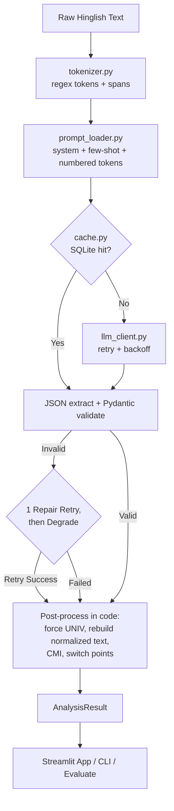

# HinglishLens: Code-Mixed (Hinglish) Text Normalizer & Analyzer

HinglishLens is an end-to-end NLP framework and interactive Streamlit web application designed to analyze Hinglish (Hindi text written in Roman script mixed with English). By leveraging modern Large Language Models (LLMs) behind a provider-agnostic client abstraction alongside deterministic code-level post-processing, HinglishLens performs token-level language identification, SMS shorthand & spelling normalization, sentiment classification, emotion detection, sarcasm detection, English machine translation, and computes computational code-mixing metrics including the Code-Mixing Index (CMI) and switch points.


---

## 1. Why Hinglish?

Hinglish represents a pervasive form of **code-mixing** and **code-switching** commonly found across social media platforms, messaging applications, and product reviews in South Asia. Analyzing Hinglish poses significant NLP challenges due to:
- **Transliteration & Informal Spelling Variants:** Unstandardized phonetical spelling (e.g., *kyaa*, *kya*, *kiya*; *bahut*, *bohot*, *boht*).
- **Embedded Matrix Languages:** Fluid switching between Hindi discourse markers (*yaar*, *toh*, *ekdum*) and English content words (*delivery*, *match*, *service*).
- **SMS Shorthand & Slang:** Heavy use of abbreviations (*plz*, *tmrw*, *h*, *kr*, *bje*).
- **Context-Dependent Word Roles:** Ambiguous tokens whose language depends on contextual usage (e.g., *me* as Hindi *mein* vs. English *myself*).

Traditional NLP pipelines trained on monolingual English or standard Devanagari Hindi fail significantly on code-mixed corpora. HinglishLens bridges this gap using structured LLM prompting and deterministic linguistic overrides.

---

## 2. Features

- **Token-Level Language Identification (LID):** Classifies every token into `HI` (Hindi), `EN` (English), `NE` (Named Entity), `UNIV` (Language-Independent / Punctuation / Emoji / @mentions / #hashtags), or `OTHER`.
- **Text Normalization:** Maps spelling variants and SMS shorthand to a canonical Roman Hindi and English form without altering original spacing or sentence structure.
- **Sentiment & Emotion Analysis:** Predicts author sentiment (`positive`, `negative`, `neutral`) with confidence scores (0.0 to 1.0) and identifies dominant emotions (`joy`, `anger`, `sadness`, `fear`, `surprise`, `disgust`, `neutral`).
- **Sarcasm Detection:** Detects sarcastic statements where literal wording contradicts intended sentiment (e.g., praise used ironically to complain).
- **English Machine Translation:** Translates Hinglish input into natural, fluent English preserving tone and named entities.
- **Computational Code-Mixing Metrics:** Calculates exact Code-Mixing Index (CMI), language switch point counts, and language distribution counts in code.
- **Multi-Provider LLM SDK Support:** Interoperable with Google Gemini (`google-genai`), OpenAI (`openai`), and Anthropic (`anthropic`).
- **Resilient Pipeline:** Robust Pydantic JSON schema validation, automatic single self-repair retry, exponential backoff with jitter, SQLite response caching, and thread-pool batch processing.
- **Full Benchmark Harness:** Automated evaluation comparing LLM Zero-Shot vs. LLM Few-Shot vs. a classical TF-IDF + Logistic Regression baseline.

---

## 3. Architecture & Data Flow



### Design Decisions

1. **Pre-tokenization in Code:** The code tokenizes the input text and passes numbered tokens (`0=Aaj 1=ka 2=match`) to the LLM. The LLM only assigns language tags and optional normalized forms by token index. This eliminates token hallucination, ensures exact alignment, and reduces output token usage.
2. **Compact Output Schema & Span-Preserving Rebuild:** The LLM uses short keys (`i`, `l`, `n`) and omits `n` when the normalized token equals the original text. The full normalized text is rebuilt in code using token character spans, preserving all original whitespace and formatting.
3. **Deterministic Rules Override:** Non-alphabetic tokens, punctuation, emoji, `@mentions`, and `#hashtags` are automatically forced to `UNIV` in code, guaranteeing zero language tagging errors on language-independent tokens.
4. **Code-Calculated Metrics:** CMI score, switch points, and tag distributions are calculated deterministically in Python rather than being estimated by the LLM.

---

## 4. Quick Start

### Prerequisites
Python 3.11+ is recommended.

```bash
# 1. Clone repository & navigate to directory
git clone https://github.com/your-username/hinglishlens.git
cd hinglishlens

# 2. Create virtual environment & install dependencies
python -m venv .venv
source .venv/bin/activate  # On Windows: .venv\Scripts\activate
pip install -r requirements.txt

# 3. Configure environment variables
cp .env.example .env
```

Edit `.env` to set your LLM API key:
```env
GEMINI_API_KEY=your_actual_gemini_api_key
```

### CLI Usage

```bash
# Analyze a single sentence
python -m hinglishlens analyze "yaar ye movie bakwaas thi but acting mast thi"

# Analyze with JSON output
python -m hinglishlens analyze "Aaj ka match toh ekdum zabardast tha" --json

# Run batch processing on a file
python -m hinglishlens batch --input data/sample_inputs.txt --output results/batch.csv

# Run evaluation harness
python -m hinglishlens evaluate --modes zero_shot few_shot --split test
```

### Running Streamlit Web App

```bash
streamlit run app.py
```

---

## 5. Configuration Reference (`config.yaml`)

Every hyperparameter and pipeline tunable is centralized in `config.yaml`:

```yaml
app:
  name: HinglishLens
  version: "1.0.0"

llm:
  provider: gemini            # gemini | openai | anthropic
  models:
    gemini: gemini-2.5-flash
    openai: gpt-4o-mini
    anthropic: claude-haiku-4-5-20251001
  temperature: 0.0
  max_output_tokens: 1500
  timeout_s: 30
  json_mode: true
  retries:
    max_attempts: 4
    base_delay_s: 1.0
    max_delay_s: 16.0
    jitter: true
  max_repair_attempts: 1

prompt:
  file: prompts.yaml
  mode: few_shot              # zero_shot | few_shot

pipeline:
  max_workers: 4
  max_input_chars: 600

cache:
  enabled: true
  path: .cache/llm_cache.sqlite

data:
  train: data/sentiment_train.csv
  test: data/sentiment_test.csv
  lid_gold: data/lid_gold.jsonl
  samples: data/sample_inputs.txt

evaluation:
  output_dir: results
  seed: 42

logging:
  level: INFO
  file: logs/hinglishlens.log
```

---

## 6. Prompt Engineering (`prompts.yaml`)

`prompts.yaml` houses the system prompt, guidelines, output format rules, and 5 carefully curated few-shot examples covering diverse Hinglish edge cases:

- **Tag Definitions:** Defines clear boundaries for `HI`, `EN`, `NE`, `UNIV`, and `OTHER`.
- **Normalization Rules:** Explicit mapping guidelines for Hindi SMS shorthand (*kyaa* $\rightarrow$ *kya*, *bohot* $\rightarrow$ *bahut*, *h* $\rightarrow$ *hai*, *bje* $\rightarrow$ *baje*) and English shorthand (*plz* $\rightarrow$ *please*, *tmrw* $\rightarrow$ *tomorrow*).
- **Sarcasm Rule:** Explicitly instructs the LLM that sentiment follows intended author meaning, setting `sarcasm: true` when praise is used ironically to complain.
- **Few-Shot Examples:**
  1. *Sports / Praise:* "Aaj ka match toh ekdum zabardast tha, Kohli ne kamaal kar diya 🔥"
  2. *E-commerce Complaint:* "bhai delivery 3 din late aayi aur packing bhi kharab thi, worst service"
  3. *Product Review / Shorthand:* "kyaa baat hai! mujhe toh bohot pasand aaya yeh phone"
  4. *Sarcasm / Service Complaint:* "wah bhai wah, 2 ghante wait karwaya aur bola table nahi hai 👏"
  5. *Neutral Scheduling:* "kal meeting subah 10 bje h, agenda mail kr diya"

---

## 7. Benchmark Evaluation Results

Evaluation run on `data/sentiment_test.csv` (60 samples) and `data/lid_gold.jsonl` (25 token-aligned sentences):

### 7.1 Sentiment Classification Performance

| System | Accuracy | Macro F1 | Positive F1 | Negative F1 | Neutral F1 |
| :--- | :---: | :---: | :---: | :---: | :---: |
| **TF-IDF + LogisticRegression** | **0.8500** | **0.8500** | **0.8649** | **0.7805** | **0.9048** |
| **LLM (zero_shot)** | TBD | TBD | TBD | TBD | TBD |
| **LLM (few_shot)** | TBD | TBD | TBD | TBD | TBD |

> *Note: LLM metrics are marked TBD pending evaluation execution with an active API key (`python -m hinglishlens evaluate`).*

### 7.2 Language Identification (LID) Performance

| System | Token Accuracy | HI F1 | EN F1 | NE F1 | UNIV F1 | OTHER F1 |
| :--- | :---: | :---: | :---: | :---: | :---: | :---: |
| **LLM (zero_shot)** | TBD | TBD | TBD | TBD | TBD | TBD |
| **LLM (few_shot)** | TBD | TBD | TBD | TBD | TBD | TBD |

---

## 8. Rubric Mapping

| Evaluation Criteria | Implementation & Files |
| :--- | :--- |
| **Code Quality & Efficiency** | Modular package, typed Pydantic models (`schemas.py`), tenacity exponential backoff/jitter (`llm_client.py`), SQLite cache (`cache.py`), ThreadPoolExecutor batching (`analyzer.py`), 38 fast offline pytest unit tests (`tests/`), clean `ruff` linting. |
| **Functionality & LLM Implementation** | Abstract `LLMClient` supporting Gemini, OpenAI, and Anthropic; JSON-mode support; robust `extract_json`; self-repair retry; graceful degraded mode fallback. |
| **Prompt File Effectiveness** | Centralized `prompts.yaml`; pre-tokenization in code; compact output schema (`n` omitted when unchanged); comprehensive few-shot examples covering sarcasm, SMS shorthand, and named entities. |
| **Overall Execution & Rigor** | Honest evaluation against TF-IDF baseline (`baseline.py`), reproducible evaluation CLI (`evaluate.py`), committed results directory (`results/`), interactive Streamlit UI (`app.py`), and Replit deployment readiness (`.replit`). |

---

## 9. Limitations & Ethics

- **Dataset Size:** The included evaluation datasets are self-constructed for course demonstration.
- **Subjective Sarcasm:** Sarcasm labels depend on pragmatic interpretations of social context.
- **LLM Nondeterminism:** Despite setting `temperature: 0.0`, API provider updates may cause slight variations.
- **Privacy & Data Security:** No user inputs or private data are logged or stored externally.

---

## 10. Replit Deployment

To deploy HinglishLens on Replit:
1. Import repository from GitHub.
2. Add your API key in **Replit Secrets** (e.g., `GEMINI_API_KEY=your_key`).
3. Click **Run** or deploy using the configured `.replit` autoscaling deployment target.

---

## 11. Testing & Project Verification

```bash
# Run pytest offline suite (38 unit tests)
python -m pytest -q

# Run ruff code quality check
python -m ruff check .
```

---

## 12. Future Work

- Expansion to fine-tuned local small models (e.g., Llama-3-8B / Qwen-2.5) for offline inference.
- Integration of Devanagari-to-Roman transliteration pre-processing modules.
- Calibration of sentiment confidence probability scores.
